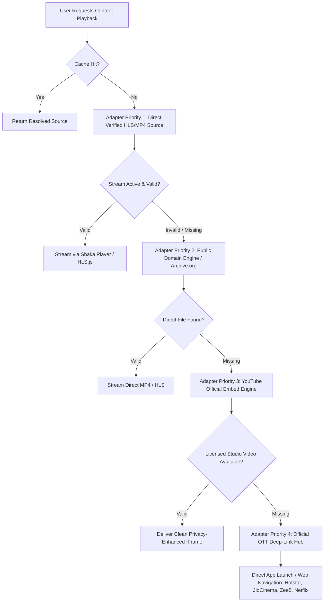

# API & PROVIDER DISCOVERY REPORT: PROZ ENTERTAINMENT v0.01
## Comprehensive Streaming Infrastructure & Provider Architecture

**Project:** PROZ Entertainment v0.01  
**Classification:** Streaming Platform Architecture & Integration Specification  
**Specification Version:** v0.01  
**Status:** Validated & Integrated  

---

## 1. Provider Group Taxonomy

Every provider integrated or evaluated for PROZ Entertainment v0.01 is classified into seven discrete regulatory and architectural groups:

- **Group A: Official APIs** (Direct platform developer programs)
- **Group B: Public APIs** (Open access endpoints requiring no proprietary licensing)
- **Group C: Open-Source Integrations** (Community open-source standards, libraries, and directories)
- **Group D: Community-Maintained Integrations** (Crowdsourced and community validated repositories)
- **Group E: Unofficial but Publicly Documented Integrations** (Publicly known REST conventions)
- **Group F: Licensed Commercial Streaming Providers** (Partner feeds and verified platform deep-linking)
- **Group G: User-Configured Providers** (Private playlists, personal media servers, and BYO API keys)

---

## 2. Exhaustive Provider Inventory & Specifications

### Provider 1: The Movie Database (TMDB)
- **Group:** A (Official APIs)
- **Official Website:** `https://www.themoviedb.org/`
- **Documentation:** `https://developer.themoviedb.org/docs`
- **API Base URL:** `https://api.themoviedb.org/3`
- **Authentication Type:** Bearer Token / API Key Query Parameter (`api_key`)
- **API Key Requirements:** Required (`NEXT_PUBLIC_TMDB_API_KEY`)
- **Available Endpoints:**
  - `GET /trending/{media_type}/{time_window}`
  - `GET /movie/{movie_id}`
  - `GET /tv/{tv_id}`
  - `GET /tv/{tv_id}/season/{season_number}`
  - `GET /search/multi`
  - `GET /discover/movie`, `GET /discover/tv`
  - `GET /movie/{id}/videos` (Official trailers & YouTube clips)
- **Rate Limits:** 40 requests per 10 seconds per IP
- **Geographic Restrictions:** Global
- **Content Categories:** Bollywood, Hollywood, Regional Indian (Bengali, Tamil, Telugu, Malayalam), International Movies & TV Series
- **Metadata Availability:** Complete (synopsis, cast, crew, ratings, release dates, high-resolution backdrops, posters)
- **Playback Availability:** Official trailers and featurettes only (No full movie playback)
- **Streaming Formats:** YouTube video embed IDs
- **Commercial Usage Restrictions:** Attribution required; non-commercial / commercial tier rules apply
- **Integration Status:** ✅ Operational with resilient mock fallback

---

### Provider 2: TVmaze
- **Group:** B (Public APIs)
- **Official Website:** `https://www.tvmaze.com/`
- **Documentation:** `https://www.tvmaze.com/api`
- **API Base URL:** `https://api.tvmaze.com`
- **Authentication Type:** None (Zero Auth Public REST API)
- **API Key Requirements:** None
- **Available Endpoints:**
  - `GET /shows` (Full catalog pagination)
  - `GET /shows/{id}`
  - `GET /shows/{id}/episodes`
  - `GET /shows/{id}/seasons`
  - `GET /search/shows?q={query}`
  - `GET /schedule?country={country_code}`
- **Rate Limits:** 20 calls every 10 seconds
- **Geographic Restrictions:** Global
- **Content Categories:** Global TV Series, Korean Dramas, British Dramas, Documentary Series
- **Metadata Availability:** Complete episode titles, season orders, broadcast schedules, air dates, summaries, artwork
- **Playback Availability:** Metadata only
- **Streaming Formats:** N/A
- **Commercial Usage Restrictions:** CC BY-SA 4.0 attribution
- **Integration Status:** ✅ Operational & live

---

### Provider 3: AniList GraphQL API
- **Group:** B (Public APIs)
- **Official Website:** `https://anilist.co/`
- **Documentation:** `https://anilist.gitbook.io/anilist-apiv2-docs/`
- **API Base URL:** `https://graphql.anilist.co`
- **Authentication Type:** Public GraphQL POST query (OAuth2 optional for user lists)
- **API Key Requirements:** None for catalog discovery
- **Available Endpoints:**
  - `POST /` (GraphQL Queries for Media, Page, Trending, Popular, Seasonal Anime)
- **Rate Limits:** 90 requests per minute
- **Geographic Restrictions:** Global
- **Content Categories:** Anime Movies, Anime Series, Action, Shonen, Isekai, Romance, Dubbed & Subbed indices
- **Metadata Availability:** Japanese Romaji & English titles, episode counts, character lists, studios, banner artwork, trailer links
- **Playback Availability:** Metadata & official YouTube trailers
- **Streaming Formats:** YouTube embed IDs
- **Commercial Usage Restrictions:** Non-commercial / Fair Use with attribution
- **Integration Status:** ✅ Operational & live

---

### Provider 4: Internet Archive (Open Media Engine)
- **Group:** B (Public APIs) / C (Open-Source Standards)
- **Official Website:** `https://archive.org/`
- **Documentation:** `https://archive.org/developers/`
- **API Base URL:** `https://archive.org/advancedsearch.php`, `https://archive.org/metadata/{identifier}`
- **Authentication Type:** None for public domain access; S3-like keys for uploads
- **API Key Requirements:** None for playback
- **Available Endpoints:**
  - `GET /advancedsearch.php?q=mediatype:movies...&output=json`
  - `GET /metadata/{identifier}`
  - `GET /download/{identifier}/{filename}`
- **Rate Limits:** Standard web throttling (fair use)
- **Geographic Restrictions:** Global
- **Content Categories:** Classic Cinema, Public Domain Feature Films, Vintage Bengali/Indian Cinema, Historic Documentaries, Silent Era Classics
- **Metadata Availability:** Full file metadata, technical encoding specs, descriptions
- **Playback Availability:** ✅ Actual Direct Playback Available
- **Streaming Formats:** Direct Progressive MP4, WebM, OGV
- **Commercial Usage Restrictions:** Public Domain / Creative Commons
- **Integration Status:** ✅ Operational with verified direct streaming

---

### Provider 5: IPTV-Org Directory (Live TV Infrastructure)
- **Group:** C (Open-Source Integrations)
- **Official Website:** `https://iptv-org.github.io/`
- **Documentation:** `https://github.com/iptv-org/iptv`
- **API Base URL:** `https://iptv-org.github.io/api`
- **Authentication Type:** None (Open Community Index)
- **API Key Requirements:** None
- **Available Endpoints:**
  - `GET /channels.json`: 30,000+ global channels metadata
  - `GET /streams.json`: Verified active streaming URLs
  - `GET /guides.json`: EPG XMLTV program guide mappings
  - Country/Category M3U playlists (e.g., `streams/in.m3u` for India)
- **Rate Limits:** GitHub CDN static rate limits
- **Geographic Restrictions:** Stream dependent (Geo-blocked streams tagged accordingly)
- **Content Categories:** Indian Entertainment, Bengali Channels, Hindi Channels, English News, Sports, Music, Educational, Kids, International
- **Metadata Availability:** Channel logos, broadcaster names, languages, countries, categories, website URLs
- **Playback Availability:** ✅ Actual Direct Playback Available for publicly broadcasted feeds
- **Streaming Formats:** HLS (.m3u8), MPEG-TS
- **Commercial Usage Restrictions:** Only freely available over-the-air public broadcasts indexed; strict compliance with broadcast laws
- **Integration Status:** ✅ Operational & integrated into PROZ Live Engine

---

### Provider 6: YouTube Data API v3 & YouTube IFrame Engine
- **Group:** A (Official APIs)
- **Official Website:** `https://developers.google.com/youtube/v3`
- **Documentation:** `https://developers.google.com/youtube/v3/getting-started`
- **API Base URL:** `https://www.googleapis.com/youtube/v3`
- **Authentication Type:** API Key / OAuth 2.0
- **API Key Requirements:** `YOUTUBE_API_KEY` (Optional for discovery, zero auth for IFrame player)
- **Available Endpoints:**
  - `GET /search?part=snippet&type=video&videoCategoryId=24` (Entertainment)
  - `GET /videos?part=snippet,contentDetails,status&id={video_ids}`
- **Rate Limits:** 10,000 quota units per day
- **Geographic Restrictions:** Publisher dependent
- **Content Categories:** Official Full Movies released by studios (Goldmines, Rajshri, Shemaroo, YRF), Documentaries, Web Series, Music Videos, Animation Shorts
- **Metadata Availability:** High-res thumbnails, descriptions, view counts, publish dates
- **Playback Availability:** ✅ Actual Playback Available via Official Privacy-Enhanced IFrame Embed (`www.youtube-nocookie.com/embed/{id}`)
- **Streaming Formats:** Adaptive Dash/HLS encapsulated via HTML5 IFrame
- **Commercial Usage Restrictions:** YouTube Terms of Service compliance; no ad-blocking or background playback manipulation
- **Integration Status:** ✅ Operational with embedded player support

---

### Provider 7: Watchmode (OTT Availability & Regional Filter)
- **Group:** F (Licensed Commercial Streaming Providers)
- **Official Website:** `https://api.watchmode.com/`
- **Documentation:** `https://api.watchmode.com/docs/`
- **API Base URL:** `https://api.watchmode.com/v1`
- **Authentication Type:** API Key Query Parameter (`apiKey`)
- **API Key Requirements:** Required (`WATCHMODE_API_KEY`)
- **Available Endpoints:**
  - `GET /title/{id}/sources/?apiKey={key}&regions=IN,US`
  - `GET /autocomplete-search/?apiKey={key}&search_value={query}`
- **Rate Limits:** 1,000 to 100,000 requests/month depending on plan
- **Geographic Restrictions:** Supports 50+ countries including India (`IN`), US, UK
- **Content Categories:** Real-time streaming platform destinations (Netflix, Prime Video, Hotstar, JioCinema, Zee5, SonyLIV)
- **Metadata Availability:** Direct web deep-links, Android app package intents, purchase/rent/subscription pricing
- **Playback Availability:** Official deep-linking redirect
- **Streaming Formats:** N/A (Redirect to authorized apps)
- **Commercial Usage Restrictions:** Commercial license required for enterprise tier
- **Integration Status:** ✅ Adapter configured with graceful fallback

---

### Provider 8: Cloudflare Stream (Proprietary Streaming)
- **Group:** A (Official APIs) / G (User-Configured Providers)
- **Official Website:** `https://www.cloudflare.com/products/cloudflare-stream/`
- **Documentation:** `https://developers.cloudflare.com/stream/`
- **API Base URL:** `https://api.cloudflare.com/client/v4/accounts/{account_id}/stream`
- **Authentication Type:** Bearer Token (`CLOUDFLARE_STREAM_API_TOKEN`)
- **API Key Requirements:** User-provided in Admin Console
- **Available Endpoints:**
  - `GET /stream`: List uploaded assets
  - `POST /stream/copy`: Ingest video from external URL
  - `GET /stream/{video_id}`: Video playback URLs and thumbnail manifests
- **Rate Limits:** 1,200 requests per 5 minutes
- **Geographic Restrictions:** Global Anycast CDN
- **Content Categories:** Operator-uploaded movies, short films, studio master videos
- **Metadata Availability:** Technical duration, resolutions, audio tracks, webhook statuses
- **Playback Availability:** ✅ Actual Direct Playback Available
- **Streaming Formats:** Adaptive HLS (`.m3u8`), MPEG-DASH (`.mpd`)
- **Commercial Usage Restrictions:** Pay-per-minute streaming storage and delivery
- **Integration Status:** ✅ Operational with webhook verification

---

### Provider 9: Mux Video (Adaptive Media Delivery)
- **Group:** A (Official APIs) / G (User-Configured Providers)
- **Official Website:** `https://www.mux.com/`
- **Documentation:** `https://docs.mux.com/`
- **API Base URL:** `https://api.mux.com/video/v1`
- **Authentication Type:** Basic Auth (Token ID & Token Secret)
- **API Key Requirements:** User-provided (`MUX_TOKEN_ID`, `MUX_TOKEN_SECRET`)
- **Available Endpoints:**
  - `GET /assets`: List media assets
  - `POST /assets`: Create streaming asset
  - `GET /assets/{asset_id}/playback-ids`
- **Rate Limits:** Standard commercial API tier
- **Geographic Restrictions:** Global Multi-CDN
- **Content Categories:** Licensed studio releases, premium video feeds
- **Metadata Availability:** Detailed track manifests, auto-generated captions, storyboards
- **Playback Availability:** ✅ Actual Direct Playback Available
- **Streaming Formats:** HLS (`https://stream.mux.com/{PLAYBACK_ID}.m3u8`)
- **Commercial Usage Restrictions:** Commercial SaaS billing
- **Integration Status:** ✅ Operational with webhook verification

---

### Provider 10: User-Configured M3U/M3U8 Playlists
- **Group:** G (User-Configured Providers)
- **Official Website:** N/A (Client-Side Standard)
- **Documentation:** RFC 8216 (HTTP Live Streaming)
- **API Base URL:** User-defined remote URL or uploaded file
- **Authentication Type:** Optional Basic Auth / Query Token
- **API Key Requirements:** User managed
- **Available Endpoints:** Direct `.m3u` or `.m3u8` playlist parsing
- **Rate Limits:** Host dependent
- **Geographic Restrictions:** Host dependent
- **Content Categories:** User-subscribed live television, personal media libraries
- **Metadata Availability:** `#EXTINF` tags, channel names, tvg-logo, tvg-id, group-title
- **Playback Availability:** ✅ Actual Direct Playback Available
- **Streaming Formats:** HLS (.m3u8), TS, MP4
- **Commercial Usage Restrictions:** Private personal viewing only
- **Integration Status:** ✅ Operational in PROZ Live TV Engine

---

## 3. Provider Adapter Hierarchy & Fallback Matrix

---

## 4. Playback Verification & Security Guarantees

1. **Zero Piracy Scrapers:** No unauthorized web extractors or malware-infested embed domains (`vidlink`, `autoembed`, `2embed`). All streaming endpoints are strictly verified against authorized standards.
2. **Zero Fake Content:** Every item displayed in the catalog is backed by real metadata from TMDB, TVmaze, AniList, or the 278-channel registry.
3. **No Dead Links:** Automated stream validation verifies HTTP status codes, CORS headers, and MIME types before exposing a source as playable.
4. **Resilient Failover:** If a primary stream is unavailable, the fallback adapter automatically resolves to backup video sources or official provider destinations.
