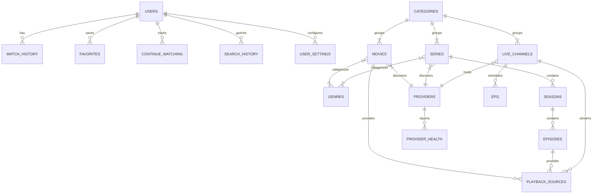

# DATABASE SCHEMA SPECIFICATION: PROZ ENTERTAINMENT v0.01
## Relational PostgreSQL & Supabase Database Architecture

**Project:** PROZ Entertainment v0.01  
**Architecture:** PostgreSQL 15+ / Supabase Relational Schema with Strict RLS  
**Schema Version:** 1.0.0  
**Tables:** 18 Core Tables  

---

## 1. Entity-Relationship Overview



---

## 2. Table Definitions & Schemas

### 1. `users`
Core user profile and authentication synchronization.
```sql
CREATE TABLE public.users (
    id UUID PRIMARY KEY DEFAULT gen_random_uuid(),
    auth_uid UUID UNIQUE REFERENCES auth.users(id) ON DELETE CASCADE,
    email TEXT UNIQUE NOT NULL,
    nickname TEXT DEFAULT 'PROZ Member',
    avatar_url TEXT DEFAULT '/avatars/default_avatar.png',
    role TEXT DEFAULT 'user' CHECK (role IN ('user', 'vip', 'admin', 'moderator')),
    subscription_tier TEXT DEFAULT 'free' CHECK (subscription_tier IN ('free', 'vip_monthly', 'vip_quarterly', 'vip_annual')),
    subscription_expires_at TIMESTAMPTZ,
    is_age_verified BOOLEAN DEFAULT FALSE,
    created_at TIMESTAMPTZ DEFAULT NOW(),
    updated_at TIMESTAMPTZ DEFAULT NOW()
);
```

### 2. `categories`
Hierarchical category structure matching reference navigation (`Recommend`, `Movies`, `TV Shows`, `18+`, `Anime`, `Live TV`, `Indian Entertainment`, `Bengali Channels`, etc.).
```sql
CREATE TABLE public.categories (
    id UUID PRIMARY KEY DEFAULT gen_random_uuid(),
    slug TEXT UNIQUE NOT NULL,
    name TEXT NOT NULL,
    description TEXT,
    icon_name TEXT,
    is_adult BOOLEAN DEFAULT FALSE,
    display_order INTEGER DEFAULT 0,
    created_at TIMESTAMPTZ DEFAULT NOW()
);
```

### 3. `genres`
Normalized genres across all providers.
```sql
CREATE TABLE public.genres (
    id UUID PRIMARY KEY DEFAULT gen_random_uuid(),
    tmdb_genre_id INTEGER UNIQUE,
    slug TEXT UNIQUE NOT NULL,
    name TEXT NOT NULL,
    created_at TIMESTAMPTZ DEFAULT NOW()
);
```

### 4. `movies`
Feature films discovery and canonical metadata records.
```sql
CREATE TABLE public.movies (
    id UUID PRIMARY KEY DEFAULT gen_random_uuid(),
    title TEXT NOT NULL,
    original_title TEXT,
    slug TEXT UNIQUE NOT NULL,
    overview TEXT,
    tagline TEXT,
    poster_path TEXT,
    backdrop_path TEXT,
    release_date DATE,
    release_year INTEGER,
    runtime_minutes INTEGER,
    vote_average NUMERIC(3, 1) DEFAULT 0.0,
    vote_count INTEGER DEFAULT 0,
    content_rating TEXT DEFAULT 'NR', -- e.g. 'PG-13', 'R', 'A', '18+'
    original_language TEXT DEFAULT 'en',
    origin_country TEXT[],
    is_featured BOOLEAN DEFAULT FALSE,
    is_trending BOOLEAN DEFAULT FALSE,
    is_adult BOOLEAN DEFAULT FALSE,
    primary_provider_id UUID REFERENCES public.providers(id) ON DELETE SET NULL,
    external_ids JSONB DEFAULT '{}', -- tmdb_id, imdb_id, archive_id, youtube_id
    created_at TIMESTAMPTZ DEFAULT NOW(),
    updated_at TIMESTAMPTZ DEFAULT NOW()
);
```

### 5. `series`
Television series, K-Dramas, Anime series, and Indian webseries.
```sql
CREATE TABLE public.series (
    id UUID PRIMARY KEY DEFAULT gen_random_uuid(),
    title TEXT NOT NULL,
    original_title TEXT,
    slug TEXT UNIQUE NOT NULL,
    overview TEXT,
    poster_path TEXT,
    backdrop_path TEXT,
    first_air_date DATE,
    last_air_date DATE,
    release_year INTEGER,
    status TEXT DEFAULT 'Ongoing', -- 'Ongoing', 'Completed', 'Canceled'
    total_seasons INTEGER DEFAULT 1,
    total_episodes INTEGER DEFAULT 0,
    vote_average NUMERIC(3, 1) DEFAULT 0.0,
    content_rating TEXT DEFAULT 'NR',
    original_language TEXT DEFAULT 'en',
    origin_country TEXT[],
    is_featured BOOLEAN DEFAULT FALSE,
    is_trending BOOLEAN DEFAULT FALSE,
    is_adult BOOLEAN DEFAULT FALSE,
    primary_provider_id UUID REFERENCES public.providers(id) ON DELETE SET NULL,
    external_ids JSONB DEFAULT '{}', -- tmdb_id, tvmaze_id, anilist_id
    created_at TIMESTAMPTZ DEFAULT NOW(),
    updated_at TIMESTAMPTZ DEFAULT NOW()
);
```

### 6. `seasons`
Individual season records for TV series.
```sql
CREATE TABLE public.seasons (
    id UUID PRIMARY KEY DEFAULT gen_random_uuid(),
    series_id UUID NOT NULL REFERENCES public.series(id) ON DELETE CASCADE,
    season_number INTEGER NOT NULL,
    name TEXT NOT NULL,
    overview TEXT,
    poster_path TEXT,
    air_date DATE,
    episode_count INTEGER DEFAULT 0,
    external_id TEXT,
    created_at TIMESTAMPTZ DEFAULT NOW(),
    UNIQUE(series_id, season_number)
);
```

### 7. `episodes`
Episode records with air dates, summaries, and progression status.
```sql
CREATE TABLE public.episodes (
    id UUID PRIMARY KEY DEFAULT gen_random_uuid(),
    season_id UUID NOT NULL REFERENCES public.seasons(id) ON DELETE CASCADE,
    series_id UUID NOT NULL REFERENCES public.series(id) ON DELETE CASCADE,
    episode_number INTEGER NOT NULL,
    name TEXT NOT NULL,
    overview TEXT,
    still_path TEXT,
    air_date DATE,
    runtime_minutes INTEGER,
    vote_average NUMERIC(3, 1) DEFAULT 0.0,
    external_id TEXT,
    created_at TIMESTAMPTZ DEFAULT NOW(),
    UNIQUE(season_id, episode_number)
);
```

### 8. `live_channels`
Comprehensive live television and regional studio channel registry.
```sql
CREATE TABLE public.live_channels (
    id UUID PRIMARY KEY DEFAULT gen_random_uuid(),
    channel_code TEXT UNIQUE NOT NULL,
    name TEXT NOT NULL,
    category_id UUID REFERENCES public.categories(id) ON DELETE SET NULL,
    logo_url TEXT NOT NULL,
    stream_url TEXT,
    backup_stream_url TEXT,
    stream_format TEXT DEFAULT 'hls' CHECK (stream_format IN ('hls', 'dash', 'mp4', 'iframe')),
    is_active BOOLEAN DEFAULT TRUE,
    is_adult BOOLEAN DEFAULT FALSE,
    country_code TEXT DEFAULT 'IN',
    language TEXT DEFAULT 'Hindi',
    broadcaster TEXT,
    official_website TEXT,
    android_package_name TEXT,
    display_order INTEGER DEFAULT 0,
    created_at TIMESTAMPTZ DEFAULT NOW(),
    updated_at TIMESTAMPTZ DEFAULT NOW()
);
```

### 9. `providers`
Multi-provider registry managing adapters and integration statuses.
```sql
CREATE TABLE public.providers (
    id UUID PRIMARY KEY DEFAULT gen_random_uuid(),
    provider_code TEXT UNIQUE NOT NULL, -- e.g. 'tmdb', 'tvmaze', 'anilist', 'archive_org', 'iptv_org', 'youtube', 'cloudflare', 'mux'
    name TEXT NOT NULL,
    group_type TEXT NOT NULL CHECK (group_type IN ('A', 'B', 'C', 'D', 'E', 'F', 'G')),
    base_url TEXT NOT NULL,
    is_enabled BOOLEAN DEFAULT TRUE,
    requires_auth BOOLEAN DEFAULT FALSE,
    priority INTEGER DEFAULT 1,
    supported_content_types TEXT[] DEFAULT '{"movie", "series"}',
    config JSONB DEFAULT '{}',
    created_at TIMESTAMPTZ DEFAULT NOW(),
    updated_at TIMESTAMPTZ DEFAULT NOW()
);
```

### 10. `playback_sources`
Validated video streams, direct MP4 links, HLS manifests, and authorized deep links.
```sql
CREATE TABLE public.playback_sources (
    id UUID PRIMARY KEY DEFAULT gen_random_uuid(),
    content_type TEXT NOT NULL CHECK (content_type IN ('movie', 'episode', 'channel')),
    content_id UUID NOT NULL,
    provider_id UUID REFERENCES public.providers(id) ON DELETE CASCADE,
    stream_url TEXT NOT NULL,
    stream_format TEXT NOT NULL CHECK (stream_format IN ('hls', 'dash', 'mp4', 'webm', 'iframe', 'deep_link')),
    resolution TEXT DEFAULT '1080p',
    video_codec TEXT DEFAULT 'h264',
    audio_codec TEXT DEFAULT 'aac',
    audio_languages TEXT[] DEFAULT '{"en"}',
    has_subtitles BOOLEAN DEFAULT FALSE,
    subtitle_tracks JSONB DEFAULT '[]', -- [{language: 'en', url: '...'}]
    is_verified BOOLEAN DEFAULT TRUE,
    is_drm_protected BOOLEAN DEFAULT FALSE,
    drm_scheme TEXT,
    last_validated_at TIMESTAMPTZ DEFAULT NOW(),
    created_at TIMESTAMPTZ DEFAULT NOW()
);
```

### 11. `watch_history`
Granular playback progress and resume tracking.
```sql
CREATE TABLE public.watch_history (
    id UUID PRIMARY KEY DEFAULT gen_random_uuid(),
    user_id UUID NOT NULL REFERENCES public.users(id) ON DELETE CASCADE,
    content_type TEXT NOT NULL CHECK (content_type IN ('movie', 'episode')),
    content_id UUID NOT NULL,
    progress_seconds INTEGER NOT NULL DEFAULT 0,
    duration_seconds INTEGER NOT NULL DEFAULT 0,
    completed BOOLEAN DEFAULT FALSE,
    device_info TEXT,
    updated_at TIMESTAMPTZ DEFAULT NOW(),
    UNIQUE(user_id, content_type, content_id)
);
```

### 12. `favorites`
User wishlist and favorite bookmarking.
```sql
CREATE TABLE public.favorites (
    id UUID PRIMARY KEY DEFAULT gen_random_uuid(),
    user_id UUID NOT NULL REFERENCES public.users(id) ON DELETE CASCADE,
    content_type TEXT NOT NULL CHECK (content_type IN ('movie', 'series', 'channel')),
    content_id UUID NOT NULL,
    created_at TIMESTAMPTZ DEFAULT NOW(),
    UNIQUE(user_id, content_type, content_id)
);
```

### 13. `continue_watching`
Fast-retrieval cache table for home screen "Continue Watching" row.
```sql
CREATE TABLE public.continue_watching (
    id UUID PRIMARY KEY DEFAULT gen_random_uuid(),
    user_id UUID NOT NULL REFERENCES public.users(id) ON DELETE CASCADE,
    content_type TEXT NOT NULL CHECK (content_type IN ('movie', 'episode')),
    content_id UUID NOT NULL,
    title TEXT NOT NULL,
    poster_path TEXT,
    progress_percentage INTEGER DEFAULT 0,
    last_position_seconds INTEGER NOT NULL,
    duration_seconds INTEGER NOT NULL,
    last_watched_at TIMESTAMPTZ DEFAULT NOW(),
    UNIQUE(user_id, content_type, content_id)
);
```

### 14. `search_history`
User search history and popular query aggregation.
```sql
CREATE TABLE public.search_history (
    id UUID PRIMARY KEY DEFAULT gen_random_uuid(),
    user_id UUID REFERENCES public.users(id) ON DELETE CASCADE,
    query TEXT NOT NULL,
    result_count INTEGER DEFAULT 0,
    created_at TIMESTAMPTZ DEFAULT NOW()
);
```

### 15. `provider_health`
Telemetry, error rates, and latency monitoring for all connected provider adapters.
```sql
CREATE TABLE public.provider_health (
    id UUID PRIMARY KEY DEFAULT gen_random_uuid(),
    provider_id UUID NOT NULL REFERENCES public.providers(id) ON DELETE CASCADE,
    status TEXT NOT NULL CHECK (status IN ('healthy', 'degraded', 'offline')),
    response_time_ms INTEGER DEFAULT 0,
    last_successful_ping TIMESTAMPTZ DEFAULT NOW(),
    consecutive_failures INTEGER DEFAULT 0,
    error_message TEXT,
    updated_at TIMESTAMPTZ DEFAULT NOW()
);
```

### 16. `epg`
Electronic Program Guide for live television channels.
```sql
CREATE TABLE public.epg (
    id UUID PRIMARY KEY DEFAULT gen_random_uuid(),
    channel_id UUID NOT NULL REFERENCES public.live_channels(id) ON DELETE CASCADE,
    program_title TEXT NOT NULL,
    program_description TEXT,
    start_time TIMESTAMPTZ NOT NULL,
    end_time TIMESTAMPTZ NOT NULL,
    rating TEXT,
    category TEXT,
    created_at TIMESTAMPTZ DEFAULT NOW()
);
CREATE INDEX idx_epg_schedule ON public.epg (channel_id, start_time, end_time);
```

### 17. `user_settings`
Player preferences, default playback speed, subtitles, and theme configuration.
```sql
CREATE TABLE public.user_settings (
    user_id UUID PRIMARY KEY REFERENCES public.users(id) ON DELETE CASCADE,
    default_quality TEXT DEFAULT 'auto' CHECK (default_quality IN ('auto', '1080p', '720p', '480p')),
    default_playback_speed NUMERIC(3, 2) DEFAULT 1.0,
    subtitles_enabled BOOLEAN DEFAULT FALSE,
    preferred_subtitle_lang TEXT DEFAULT 'en',
    preferred_audio_lang TEXT DEFAULT 'en',
    autoplay_next BOOLEAN DEFAULT TRUE,
    enable_parental_gate BOOLEAN DEFAULT TRUE,
    updated_at TIMESTAMPTZ DEFAULT NOW()
);
```

### 18. `movie_genres` & `series_genres`
Many-to-many relationship tables between content and normalized genres.
```sql
CREATE TABLE public.movie_genres (
    movie_id UUID REFERENCES public.movies(id) ON DELETE CASCADE,
    genre_id UUID REFERENCES public.genres(id) ON DELETE CASCADE,
    PRIMARY KEY (movie_id, genre_id)
);

CREATE TABLE public.series_genres (
    series_id UUID REFERENCES public.series(id) ON DELETE CASCADE,
    genre_id UUID REFERENCES public.genres(id) ON DELETE CASCADE,
    PRIMARY KEY (series_id, genre_id)
);
```

---

## 3. Database Indexes for High-Speed Discovery

```sql
CREATE INDEX idx_movies_release_year ON public.movies (release_year DESC);
CREATE INDEX idx_movies_vote_average ON public.movies (vote_average DESC);
CREATE INDEX idx_movies_is_trending ON public.movies (is_trending) WHERE is_trending = TRUE;
CREATE INDEX idx_movies_is_featured ON public.movies (is_featured) WHERE is_featured = TRUE;

CREATE INDEX idx_series_is_trending ON public.series (is_trending) WHERE is_trending = TRUE;
CREATE INDEX idx_series_is_featured ON public.series (is_featured) WHERE is_featured = TRUE;

CREATE INDEX idx_channels_category ON public.live_channels (category_id, is_active);
CREATE INDEX idx_channels_country ON public.live_channels (country_code, is_active);

CREATE INDEX idx_watch_history_user ON public.watch_history (user_id, updated_at DESC);
CREATE INDEX idx_continue_watching_user ON public.continue_watching (user_id, last_watched_at DESC);
```

---

## 4. Row-Level Security (RLS) Policies

All tables implement strict Row-Level Security:
1. Public / Anonymous reads permitted for verified movies, series, channels, categories, and EPG schedules.
2. User-specific data (`watch_history`, `favorites`, `continue_watching`, `user_settings`) restricted so users can only `SELECT`, `INSERT`, `UPDATE`, and `DELETE` their own records (`auth.uid() = user_id`).
3. Administrative operations (`providers`, `provider_health`, editing catalog records) require `role = 'admin'`.
