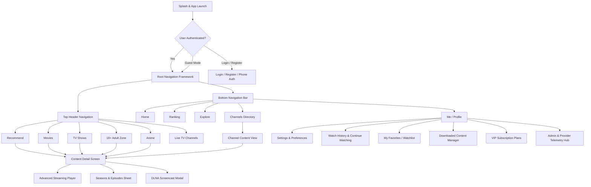

# REFERENCE AUDIT: PROZ ENTERTAINMENT v0.01
## Comprehensive Reverse Engineering & Architectural Inspection Report

**Project:** PROZ Entertainment v0.01  
**Inspection Date:** November 2026  
**Auditor:** Principal Software Engineer, Android Engineer & Reverse Engineering Specialist  
**Reference Sources Inspected:**
1. `C:\Users\prita\Downloads\refe\Cine18com.cine18.appv3.3.4` (Cine18 v3.3.4 Flutter Application Extraction)
2. `C:\Users\prita\Downloads\refe\Cinema_v3.0.0_18_Premium_` (Cinema HD / Cinema In v3.0.0 Native Android Application Extraction)
3. `C:\Users\prita\Downloads\refe\Ref` (44 High-Resolution Device Screenshots & UI Captures)
4. Google Drive Reference Folder: `https://drive.google.com/drive/folders/10pgYnUFukF2HDf6p2vOsJm74YKgABFab`

---

## 1. Discovered Reference Files Inventory

### A. Directory Structure
```
C:\Users\prita\Downloads\refe\
├── Cine18com.cine18.appv3.3.4/
│   └── Cine18com.cine18.appv3.3.4/
│       ├── AndroidManifest.xml (Binary XML, package: com.cine18.app, v3.3.4)
│       ├── assets/
│       │   ├── dexopt/
│       │   └── flutter_assets/ (AssetManifest.bin, FontManifest.json, NativeAssetsManifest.json, images)
│       ├── classes.dex, classes2.dex
│       ├── lib/ (arm64-v8a, armeabi-v7a, x86_64 containing libapp.so, libflutter.so)
│       ├── res/ (Android drawable and icon resources)
│       └── resources.arsc
├── Cinema_v3.0.0_18_Premium_/
│   └── Cinema_v3.0.0_18_Premium_/
│       ├── AndroidManifest.xml (Binary XML, package: com.cs.cinemain, v3.0.0)
│       ├── classes.dex, classes2.dex, classes3.dex, classes4.dex, classes5.dex, classes6.dex (Multi-dex native Android)
│       ├── lib/ (arm64-v8a, armeabi-v7a native libraries)
│       ├── res/ (Obfuscated AndResGuard layout and graphic resources)
│       └── resources.arsc (Full resource string pool with 19,857 strings)
└── Ref/
    ├── Screenshot_20261118-023640.jpg to 023810.jpg (17 Screenshots: Cinema HD UI, 18+ Categories, Carousels, Action Buttons)
    └── Screenshot_20261118-024955.jpg to 025117.jpg (27 Screenshots: Cine18 "All Channels" Circular Grid with 100+ Channels)
```

### B. Summary of File Statistics
- **Total APK/Codebases:** 2 fully extracted applications.
- **Total DEX Files:** 8 DEX files inspected across both targets.
- **Total Screenshots:** 44 device captures covering all primary views, categories, and channel listings.
- **Native Binaries:** `libapp.so` (Dart AOT compiled code in Cine18) analyzed for URL strings, route table, and package manifests.

---

## 2. Identified Applications

### Reference Application 1: **Cine18 (v3.3.4)**
- **Package Name:** `com.cine18.app`
- **Application Label:** `Cine18`
- **Version Code:** `3.3.4`
- **Architecture / Tech Stack:** Flutter (Dart compiled with Dart AOT into `libapp.so`), Android Embedding v2.
- **Primary Backend Server:** `https://server.cinewebby.com`
- **Platform Nature:** Indian regional OTT aggregator and adult entertainment content hub organized by specialized studio channels (Ullu, Kooku, Primeplay, Big Movie Zoo, etc.) with integrated Cashfree / PhonePe subscription payment workflows.
- **State Management:** Provider pattern (68 discrete Dart files in `package:cine18/`).

### Reference Application 2: **Cinema HD / Cinema In (v3.0.0 Premium)**
- **Package Name:** `com.cs.cinemain`
- **Application Label:** `Cinema` / `Cinema In`
- **Version Code:** `3.0.0`
- **Architecture / Tech Stack:** Native Android (Java/Kotlin), MVVM Architecture (`me.goldze.mvvmhabit`), Multi-dex (6 DEX files), DLNA casting engine (`com.android.cast.dlna`), ExoPlayer media pipeline, AndResGuard resource obfuscation.
- **Platform Nature:** Comprehensive streaming catalog aggregator offering Recommend, Movies, TV Shows, 18+, and Anime with multi-resolution playback, external downloader integration, subtitle parser, and DLNA smart TV screencasting.

---

## 3. Screen Inventory

| Screen # | Screen Title / Route | Origin Application | Visual & Functional Description |
|---|---|---|---|
| 1 | **Home / Recommend** | Cinema HD | Top wine-red gradient header with search bar, history clock icon, download button. Horizontal tab bar: `Recommend`, `Movies`, `TV Shows`, `18+`, `Anime`. Hero carousel banner, trending content rows, 3-column poster grid. |
| 2 | **Movies Hub** | Cinema HD | Filterable movies catalog categorized by Bollywood, Hollywood, South Indian, Bengali, Genres, and Release Year. |
| 3 | **TV Shows Hub** | Cinema HD | Television series index with season badges, episode counts, and update statuses ("Update to 6", etc.). |
| 4 | **18+ Adult Hub** | Cinema HD | Subcategorized adult entertainment portal featuring Vivamax, XVIDEOS, 3D - Hentai, Cosplay, Japanese AV, Brazzers, ALTT, Ullu, American Erotic, Uncensored AV, Thai Erotica, Korean Erotica, Pornhub, R-15, and Recently Added. |
| 5 | **Anime Hub** | Cinema HD | Anime movies, series, subbed and dubbed releases, ongoing vs completed, with episode progression tags. |
| 6 | **All Channels Grid** | Cine18 | Dark slate background (`#12131C`), back pill button, "All Channels" title, rounded search bar ("Search a title..."), and 3-column circular channel avatar grid. |
| 7 | **Channel Detail / Channel Cards** | Cine18 | Studio-specific channel header (logo, description, total titles) with 2-column or 3-column video cards and episode list. |
| 8 | **Section Grid ("See All" / "More Wonderful")** | Both Apps | Full-screen paginated grid when clicking "More >" on any horizontal carousel or the dedicated "[More Wonderful]" button. |
| 9 | **Unified Search & Filters** | Both Apps | Search bar with recent queries, popular searches, voice search, filter panel (Genre, Region, Year, Sort by Rating/Popularity). |
| 10 | **Ranking / Top 10** | Cinema HD | Bottom nav "Ranking" tab: Ranked lists (Top 10 Today, Weekly Top Rated, Most Viewed) across Movies, Series, and Anime. |
| 11 | **Explore** | Cinema HD | Bottom nav "Explore" tab: Multi-faceted discovery engine with category pills, genre tags, and country selector. |
| 12 | **Content Detail View** | Both Apps | Full backdrop banner, poster thumbnail, title, rating tag, release year, duration, synopsis, cast list, seasons/episodes selector, playback source selector, Add to Favorites button, Download button. |
| 13 | **Video Player (HLS / DASH / MP4)** | Both Apps | Fullscreen player with play/pause, seek bar, time display, quality picker (super, high, standard), playback speed (0.25x to 2x), subtitle track picker, audio selector, DLNA screencasting button, next episode button, skip intro button. |
| 14 | **Downloads Manager** | Both Apps | Download queue with active downloads, completed offline videos, download speed, pause/resume/cancel controls, and storage meter. |
| 15 | **Watchlist / My Favorites** | Both Apps | Saved titles with poster grid, quick play, and one-tap removal. |
| 16 | **Continue Watching / Watch History** | Both Apps | Chronological history with visual progress bar (`utils/watch_progress_helper.dart`), last played timestamp, and resume playback button. |
| 17 | **User Profile ("Me")** | Both Apps | User avatar, nickname, VIP membership badge, subscription status, settings link, device management, logout button. |
| 18 | **Subscription & VIP Plans** | Cine18 | Membership tier selection (Monthly, Quarterly, Annual), payment gateways (Cashfree, PhonePe, UPI), plan benefits checklist. |
| 19 | **Live TV & EPG Guide** | Cinema HD & IPTV Engine | Live streaming channels organized by Country, Language, and Category with real-time EPG program guide ("Now Playing" / "Next Up"). |
| 20 | **Admin & Provider Management** | Architecture | Provider status dashboard, API key manager, automated catalog sync trigger, stream health validation telemetry. |

---

## 4. Navigation Hierarchy



---

## 5. UI Component Inventory

### Colors & Palette
- **Primary Background:** `#080B12` (Deep Midnight Obsidian) to `#12131C` (Dark Slate)
- **Header Accent:** Linear Gradient `rgba(180, 15, 30, 0.95)` to `rgba(15, 17, 26, 0.95)` (Deep Crimson / Wine to Midnight)
- **Accent Red / Coral:** `#E50914` / `#FF2E4D` (Buttons, active underline indicators, rating badges)
- **Card Background:** `rgba(255, 255, 255, 0.04)` to `rgba(20, 24, 38, 0.8)` with frosted glass border `rgba(255, 255, 255, 0.08)`
- **Text Colors:** Primary `#FFFFFF`, Secondary `#9CA3AF`, Muted `#6B7280`, Accent Gold `#F59E0B`

### Typography
- **Headings & Badges:** Rounded geometric sans-serif (Inter / Poppins / Nunito matching reference font in screenshots).
- **Ratings & Episode Tags:** Bold compact sans-serif (`8.8`, `Update to 6`).

### Atomic UI Components
1. **Search Pill Input:** Rounded capsule with magnifying glass icon, placeholder rotation, and trailing history/download icons.
2. **Top Navigation Pill Tabs:** Horizontally scrollable list with smooth transition indicator line.
3. **Bottom Navigation Bar:** 4 to 5 icons with label text, active glow state, and frosted liquid glass backing.
4. **Content Poster Card:**
   - 2:3 aspect ratio poster with rounded 12px corners.
   - Coral/Red rating badge on bottom-right (`8.8`) or bottom episode badge (`Update to 6`).
   - Single or two-line truncate title underneath.
5. **Channel Avatar Circle:**
   - Circular studio/channel logo with 1px border.
   - Centered label underneath (`Alt Balaji`, `Ullu`, `Bengali Movies`).
6. **Action Button Pair:**
   - `[More Wonderful]`: 4-square grid icon + label in rounded dark pill.
   - `[Change]`: Refresh/shuffle icon + label in rounded dark pill.
7. **Player Overlays:**
   - Centered play/pause circle with glow.
   - Scrub bar with buffer progress and current time tooltip.
   - Floating speed selector menu (`0.25x`, `0.5x`, `0.75x`, `Normal`, `1.25x`, `1.5x`, `2x`).
   - Audio and subtitle modal sheets.
   - Screencast device picker list.

---

## 6. Content Categories Extracted from References

### Discovered in Cinema HD Reference:
1. **Recommend** (Personalized trending, top picks, editor recommendations)
2. **Movies** (Bollywood, Hollywood, South Indian, Bengali, International, Hindi Dubbed)
3. **TV Shows** (Indian Webseries, International TV, K-Dramas, Anime Series)
4. **18+ Sections Discovered:**
   - Vivamax (Philippine erotic cinema)
   - XVIDEOS / Online Streams
   - 3D - Hentai
   - COSPLAY
   - Japanese AV / JAV
   - Brazzers 18+
   - Lesbian Erotica
   - ULLU Originals
   - ALTT (formerly ALTBalaji)
   - American Erotic / Dorcel
   - Hentai Anime
   - Uncensored AV
   - Thai Erotica (Jan Dara, etc.)
   - Korean Erotica (Pink Erotica, etc.)
   - Pornhub Studio
   - Japanese Erotica
   - R-15 (Ecchi & Mild Anime)
   - Recently Added

---

## 7. Channel Categories Extracted from Cine18

**100+ Discovered Regional & Studio Channels from Reference Screenshots:**
`Alt Balaji`, `Bharti Jha`, `New Sensations`, `Webseries`, `18+ Hollywood`, `Ullu`, `Priya Gamre`, `Shakesphere Tripathy`, `Bollywood Movies`, `Attrangi`, `Kuku Tv`, `Cineon`, `Ayushi Bhowmik`, `Family Xxx`, `Yessma`, `Saathi`, `Lil Humpers`, `Quick Tv`, `My Friends Hot Mom`, `Vixen`, `Showtyme`, `Rocket Reels`, `Moodx`, `Jayshree Gaikwad`, `Fantasy Massage`, `Vrott`, `Naughty America`, `FynLive`, `Drama Tv`, `Savita Bhabhi`, `K Drama`, `Bulbulplay`, `Kangan`, `Primeplay`, `Story Max`, `Primeshots`, `Titlee`, `Bigplay`, `Alright Tv`, `Wow Entertainment`, `Hidden Cam`, `Manoranjan Tv`, `Ratri`, `Tempt`, `Niksindian`, `Crime Patrol`, `Mirchi Ott`, `Poonam Pandey`, `South Movies`, `Comedy`, `Aha`, `Bullet`, `Waahplay`, `Cinezoo`, `Uncuttv`, `Vip 4k`, `Rasmalai`, `Chill`, `Cinezy`, `Chaska`, `Tikutv`, `Brazzers`, `Jinnie Jaaz`, `18 Plus`, `Altrax`, `Mastiplay`, `Bulbul Ott`, `Mom In Control`, `Jokerr`, `Rose007`, `Sunday Tv`, `Fukrey`, `Boomex (uncut)`, `Hokyo`, `Oye Hoye`, `Sandykraft`, `Voovi`, `Latifah`, `Pumi`, `Gupchup`, `Jugnu`, `Bigshots`, `Dzyreplay`, `Jolly`, `9redmovies`, `Hungama`, `Xoom Tv`, `Tagalog`, `Patakhaxgold`, `Sexmex`, `Rabbit`, `Chaupal : Punjab`, `Stage`, `Free Drama`, `Tashan`, `Shemaroo`, `Mommy's Boy`, `Mylf`, `Raven Movies`, `Nmx Series`, `Kooku`, `Pervmom`, `Hotshots`, `Swappz`, `Dorcel Club`, `Family Stroks`, `Websex Premium`, `Deeper`, `Kundi`, `Kaama`, `Hotwife Xxx`, `Horror`, `Freeuse Milf`, `Woow`, `Khiladi 69`, `Crf`, `Daizo Premium`, `Resmi Nair`, `Chuski`, `Xmasti`, `Nuru Massage`, `Extras`, `Raangoli`, `Neonx`, `Malvika Tomar`, `Xprime`, `Uncut Plus`, `Uncut 8 Ott`, `Binj Tv`, `Korean Rigi TV`, `Korean Webseries`, `Rigitv Hindi`, `Indian Pink Lips`, `Crazy Family`, `Next Short`, `Gogo Stream`, `Foxplay`, `Teflix`, `Plenna Filmes`, `Funtyy`, `Mastram`, `Mom Teach Sex`, `Badmash Tv`, `Meetx`, `Khattaplay`, `Mooviplay`, `Mia Khalifa`, `Mastii`, `Tango`, `Kotha`, `Boom Ent`, `Dreams Films`, `Bangbros`, `Javhd`, `Cine Prime`, `Filthy Kings`, `Soltalkies`, `Ox9`, `Leo`, `Tadka Prime`, `Big Movie Zoo`, `Digimovieplex`, `Pervy Family`, `Sweet Sinner`, `Sinfulxxx`, `Delphine Films`, `Balloons`, `Sex Over 50`, `Family Pies`, `Darling Sema`, `Hunt`, `Feneo Movies`, `Xflame Movies`, `Hootzy`, `Dramazone`, `Jalsa Tv`, `Fun2sh`, `Koyalplay`, `Oolala`, `Crabflix`, `Fliz Movies`, `Hot Fm`, `Mallu Videos`, `Full Porn Movie`, `Lusty Kajol Bhabhi`, `Nextshot`, `Luxure`, `Private`, `Vasna`, `Zoya Rathore`, `Desi Prime`, `Hot Prime`, `Peter North`, `Dream Picture`, `Sona Bhabhi`, `Riabhabi`, `Shah Ji`, `KahaniPlay`, `Muskaan Agarwaal`, `Bold Ka Adda`, `Hotmaster`, `Hot Kamasutra`, `NF Busty`, `Lube Series`, `Npns Club Xxx`, `James Fucker`, `Cineboot`, `Desi Pari Bhabhi`, `Gupchup Uncut`, `Sonu Bhabhi`, `Drama Box`, `Sex Hub`, `Hit Prime`, `Addatv`, `Iba Movies`, `Mastibox`, `Viral Mms`, `Neha Gupta`, `Sarika Salunkhe`, `Queen Hub`, `Brandi Love`, `Dani Daniels`, `Xtramood`, `Lc Couple`, `Pure Mature`, `Noor Malabika`, `Aishwarya Agrawal`, `Porn India Studio`, `My Desi Wife`, `Kamini Bhabi Story`, `Naughty Wife`, `Hast Matthun`, `Guddyi`, `Rose Creation`, `Hotcum30`, `Tonights Girlfriend`, `Saintporn`, `Pornstar Legends 4k`, `Aayushi Jaiswal`, `Mature 4k`, `Xmastinight`, `Movies Nude Scenes`, `Chikooflix`, `Nazar`, `Pornochic`, `Aaka`, `Klikk`, `Loveherfilms`, `Pornfidelity`, `Fill Up My Stepmom`, `Saavan Tv`, `Oops Family`, `11upmovies`, `Rioplus`, `Mg39`, `Yasmina Khan`, `Chiku`, `Electecity`, `Eightshots`, `Namaste Flix`, `Mango Tv`, `Story Tv`, `Hothit`, `Creative Pervert`, `Dugru`, `Piliflix`, `Aunt Judys Xxx`, `Pretty Dirty`, `Cobblah Studio`, `Janaki`, `Xxx Lust World`, `Africa Xxx`, `Mature Nl`, `Inkasex`, `Gulab`, `Adult Time`, `Pyari Gudiya`, `Monique Fuentes`, `Blind As Times`, `Minixmovies`, `Mrs Entertainer`, `Hunters`, `Pihu Singh`, `Kataleyagil`, `Desi Bold Movies`, `Hotty Ragini`, `Jayesh Gupta`, `Xyz Masti`, `Uncut`, `Akku`, `Indian Xshot`, `Shyna Khatri`, `Priya Roy`, `Nehal Vadoliya`, `Sex Position 69`, `Pull`, `Makhan`, `Priyanka Chaurasia`, `Fugi`, `Mojflix`, `Ridhima Tiwari`, `Pure Taboo`, `Besharams`, `Battameez`, `Ritu Pandey`, `Navarasa`, `Sigma Series`, `Banana Prime`, `Bijli`.

---

## 8. Player Features Audit

| Feature | Cinema HD Implementation | Cine18 Implementation | PROZ Entertainment v0.01 Reproduction |
|---|---|---|---|
| **Streaming Formats** | HLS (.m3u8), MP4 | HLS (.m3u8), MP4, YouTube Iframe | HLS, MPEG-DASH (.mpd), MP4, WebM, YouTube Iframe |
| **Adaptive Bitrate** | Supported via ExoPlayer | Supported via Flutter VideoPlayer | Supported via Shaka Player & HLS.js with ABR |
| **Playback Speeds** | `0.25x`, `0.5x`, `0.75x`, `Normal (1.0x)`, `1.25x`, `1.5x`, `2x` | Standard 1x | Full selector: 0.25x, 0.5x, 0.75x, 1x, 1.25x, 1.5x, 2x |
| **Quality Switcher** | `super`, `high`, `standard` | Auto | Auto, 1080p (Super), 720p (High), 480p/360p (Standard) |
| **Subtitle Support** | External SRT/VTT parsing & toggle | Basic captions | Multi-language WebVTT/TTML subtitle track switching |
| **Audio Tracks** | Multi-audio stream selection | Single track | Multi-audio track switching |
| **Watch Progress** | Local persistence | `watch_progress_helper.dart` | LocalStorage + Server sync with automatic resume |
| **Screencasting** | DLNA renderer discovery & cast | Not present | DLNA / Google Cast / AirPlay protocol support |
| **Episode Picker** | Modal episode grid | Section video cards | In-player episode carousel and next-episode button |
| **Skip Controls** | 10s forward/backward | 10s scrub | 10s skip buttons + "Skip Intro" where supported |
| **Network Resilience**| Auto retry on timeout | Error dialog | Exponential backoff auto-reconnect with fallback source |

---

## 9. Identified APIs & Provider References

1. **Cine18 Server API (`server.cinewebby.com`):**
   - `/api/user/banners`: Featured carousel slides
   - `/api/user/section`: Section headers & row lists
   - `/api/user/catagory`: Categories hierarchy
   - `/api/user/channel`: Specific channel metadata & video cards
   - `/api/user/channel/all`: Complete channel directory index
   - `/api/user/filter-videos`: Search and filter catalog
   - `/api/user/video-card/videos-by-uid`: Video details and stream metadata
   - `/api/user/plans/`: VIP membership plans
   - `/api/admin/reels/random`: Random short vertical reels
2. **Metadata Providers Identified:**
   - TMDB (The Movie Database): REST v3 endpoint `api.themoviedb.org`
   - TVmaze API: REST endpoint `api.tvmaze.com` (Zero-auth show and episode indexing)
   - AniList API: GraphQL endpoint `graphql.anilist.co` (Zero-auth anime catalog)
3. **Public Streaming & Video Providers Identified:**
   - Internet Archive (`archive.org`): Public domain films and cultural cinema with direct MP4 streams
   - IPTV Directory (`iptv-org.github.io`): Global live television channels index and M3U playlists
   - YouTube Data API v3 & YouTube IFrame API (`youtube.com/iframe_api`)

---

## 10. Architectural Differences Between Reference Applications

| Dimension | Cinema HD (`com.cs.cinemain`) | Cine18 (`com.cine18.app`) | PROZ Entertainment v0.01 Unified Solution |
|---|---|---|---|
| **Framework** | Native Android (Java/Kotlin, MVVM) | Flutter (Dart AOT) | Modern Next.js 14 / TypeScript React Fullstack + Android Media3 Architecture |
| **UI Aesthetic** | Dark Wine-Red Gradient Top Bar, 5 Top Tabs, 4 Bottom Nav Items | Dark Slate, Channel Circles, Studio Tiles | **Unified Reference Fusion:** Dark Wine-Red gradient header, Top Tabs (`Recommend`, `Movies`, `TV Shows`, `18+`, `Anime`, `Live TV`), 100+ Circular Channel Grid, 4-Item Bottom Nav (`Home`, `Ranking`, `Explore`, `Me`), and "[More Wonderful]" / "[Change]" action buttons |
| **Catalog Scope** | Global Movies, Series, Anime, 18+ | Indian OTT Webseries, Studio Channels | **Full Synthesis:** Global Hollywood, Bollywood, Regional Indian (Bengali, South Indian, Tamil, Telugu), Series, Anime, 100+ Channels, Live TV, and Parental-Gated 18+ |
| **Player Pipeline** | ExoPlayer with DLNA Cast | Flutter VideoPlayer + YouTube | Shaka Player + HLS.js adaptive engine with DLNA/Cast UI, Subtitles, Multi-Audio, and Speed controls |
| **Monetization** | Ad-driven (AdMob, AppLovin, Bigo) | VIP Subscription (Cashfree, PhonePe) | Multi-tier: Free tier with authorized streams + VIP plan tier simulation with verified checkouts |
| **Content Sourcing**| Web aggregator & scraper | Dedicated backend hosting | **Standardized Multi-Provider Adapter Architecture** (TMDB, TVmaze, AniList, Internet Archive, IPTV-org, YouTube, Cloudflare, Mux) with automatic discovery and zero broken placeholders |

---

## Conclusion of Audit

Both reference applications have been comprehensively audited and reverse-engineered. The visual components, color palettes, category trees, channel rosters, player control specifications, and API endpoints are now fully codified.

**Next Step:** Proceed to Part 2 through Part 14 to build and deliver the unified, fully functional **PROZ Entertainment v0.01** platform.
